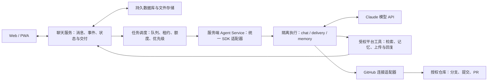

# AI Native Chat — PRD V0.8 新增范围

修订日期：2026-11-02。以下决定优先于后文保留的 V0.7 描述。

1. 所有 Agent（chat/delivery/memory 及 SDK 内部 Agent）启用完整 Claude Code 工具集与 bypassPermissions；不设置 Shell/文件工具审批或 Docker 前置条件。支持 Python、npm、依赖安装、测试与构建。权限等同于服务器进程账号，不自动获得 root/sudo。费用、轮数、超时、取消和进程回收仍生效。
2. Room 项目目录跨任务、配置更新和重启保留；SDK 会话状态与项目目录分开。完整终端可以访问服务账号能访问的本机资源，Room API 的校验不等于 OS 隔离。
3. 注册真实互联网搜索、HTTP 网页正文读取与 Playwright 通用浏览器，支持导航、点击、输入、按键、滚动、JavaScript、截图及 Cookie/本地存储续接。默认无 Key 搜索，限流/挑战明确报错；Owner 可配置其他搜索服务。回答引用实际来源 URL。
4. Owner 配置 stdio/HTTP/SSE 外部 MCP，凭证加密保存且不在页面显示明文；支持连接测试和 tools/list。所有 Agent 可调用已配置工具。日历/云盘由相应服务提供能力，需部署者提供真实认证；本轮不实现各服务专属 OAuth 登录界面。
5. 默认开放注册，注册后自动登录并创建聊天入口；新账号为普通成员，不自动成为 Owner。来源检查、频率限制、重名和密码校验生效；Owner 可关闭注册。
6. 实际执行证据作为验收：Python 测试、npm 安装/测试/构建、真实搜索浏览、真实 MCP 调用和数据读回、注册与配置页浏览器检查、完整回归。

此前不具备 Shell/网络/MCP、memory 不具备通用工具等描述由本轮决定取代。后台记忆仍以静默整理为工作目标。GitHub 专用流程、更多文件类型继续保留在后续范围。

---

# AI Native Chat — 产品需求文档（PRD V0.7）

> **产品定位：** 面向双人及小型群组的自部署私人聊天与协作软件。平台自带服务端 AI 成员：参与讨论，在聊天中交付 Markdown 文档、HTML 网页文件与 GitHub 代码变更，并在后台维护聊天回顾与精选记忆。普通用户只使用 Web / PWA，无需在自己的电脑上安装或启动 Agent。
>
> **版本：** V0.7｜**日期：** 2026-10-29｜**阶段：** 服务端统一 Agent 的 MVP 产品需求与参考架构
>
> **修订基础：** AI_Native_Chat_PRD_v0.6.md；保留聊天、原文存档、记忆和实际交付范围，统一服务端 AI 执行方案。
>
> **部署：** Web / PWA + 私人聊天服务 + 持久任务调度 + 服务端 Agent Service + 受控执行环境。初版可部署在同一台持续在线服务器，进程与数据职责分开。
>
> **首版执行方案：** 所有 AI 任务统一由服务端 Claude Agent SDK 驱动，包括对话、资料理解、文件制作、代码交付和记忆整理。Claude 模型通过云端 API 调用；本服务器运行 Agent 和工具，不部署模型权重，不要求 GPU。

## 0. V0.7 修订摘要

1. 将“用户接入外部 Agent”调整为“平台默认部署服务端 Agent”；Owner 配置一次，所有获授权用户通过聊天使用。
2. 固定一条 AI 执行路径：服务端 Claude Agent SDK。首版不为聊天、交付和记忆分别自建不同模型调用链。
3. 区分同一执行服务的 chat / delivery / memory 三种任务配置，分别管理工具、优先级、会话和额度；不是一个共享所有聊天的无限会话。
4. 增加首启配置、连通性与真实工具自检、服务状态、进程回收、会话恢复和统一用量管理。
5. 明确模型云端推理、Agent 服务端运行、客户端仅呈现交互；个人电脑关机不影响已部署服务器上的 AI 任务。
6. 保留 Markdown / HTML 实际文件、版本改稿、GitHub 分支 / PR、静默整理和全部原文存档要求。
7. 保留 HTTP API、CLI、MCP 与统一指南作为工具契约；外部终端 Agent 是可选扩展，不是普通用户使用 AI 的前置条件。
8. 扩充服务端运行、任务调度、会话隔离和故障恢复验收，并明确 SDK 之外仍由程序负责的产品机制。

## 1. 产品目标与范围

### 1.1 核心价值

**在同一个聊天里，把想法讨论清楚，把需要的东西做出来，并能拿到、使用、修改和追溯。**

对话是主要操作入口。用户无需切到终端下载临时路径、复制长代码再手工拼文件，或离开聊天另找代码提交记录。

### 1.2 核心目标

1. 保持普通 IM 的私聊、群聊、回复、搜索、收藏、归档、附件与实时同步体验。
2. AI 理解多人作者身份、引用关系、讨论变化及当前任务，能解释、比较、提出建议，并判断何时需要检索或执行。
3. 用户可以在聊天里请求制作文档、制作简单网页、修改已有交付物，或对已连接 GitHub 项目新增和修改代码。
4. 交付可打开、可下载、有稳定标识和版本，并回到发起任务的会话；外部代码操作有真实分支、提交或 PR 回执。
5. 群聊默认明确 @Agent 才发起新互动；任务中的定向回复可继续推进，不要求每一步重新 @ 或重新授权。
6. 无人 @ 时，后台仍可增量整理启用整理的 Room，精选长期记忆；普通闲聊无需全部转成记忆。
7. 原始聊天独立保存、检索、归档、导出和备份；AI 运行失败不影响普通聊天。
8. 平台保持 HTTP API、CLI、基础 MCP 和一份版本化使用指南；协议允许高级外部接入，默认产品 AI 的运行不依赖外部终端。
9. 普通用户不单独配置模型 API Key、不保持终端运行；服务端集中执行和管理 AI 任务、连接及额度。

### 1.3 代表性场景

- 两人讨论一个活动，用户说“@AI 按刚才定下来的内容做一份方案”；AI 交付可下载的活动方案.md。
- 用户继续回复该交付卡“时间改到周六，预算减少一半”；AI 基于已有版本修改并交付新版本。
- 群聊中请求“做一个报名说明网页”；AI 交付可预览、可下载的 HTML，明确其是静态说明还是具备真实提交功能。
- 用户说“把这个页面加入已经连接的 GitHub 项目”；AI 阅读项目约定，修改文件、运行相关检查、推送任务分支并创建 PR。
- 执行期间其他成员继续聊天，任务卡持续更新；用户可停止、补充要求或离线，之后回到聊天查看结果。
- 用户关闭手机或电脑后，服务端已接收的任务继续运行；重新打开 App 可看到同一任务及交付，服务器异常时显示真实状态。
- 几周后用户问“上次交付的网页和最后决定的方案是什么”；AI 能检索讨论、文件版本和 GitHub 回执并给出来源。

### 1.4 首版交付范围

| 类型 | P0 支持 | 不包含的默认承诺 |
|---|---|---|
| Markdown | 真实 .md 文件、渲染预览、下载、连续改稿与版本 | 复杂排版、DOCX / PDF 导出 |
| HTML | 简单单页、内联 CSS / JS、浏览器预览、下载；必要时资源包 ZIP | 全功能应用托管、真实收款、账号系统、自动公开上线 |
| GitHub | 已授权仓库的读取、文件新增 / 修改、隔离分支、提交、推送、PR 与检查回执 | 默认直接改主分支、合并 PR、发布 Release 或生产部署 |
| 对话执行 | 多步工具调用、必要检索、执行状态、取消、重试、继续修改 | 无边界的长期自治、多 Agent 团队编排 |

首版不建设企业项目管理、审批流、复杂任务看板、知识图谱、强制话题树、音视频通话或通用云开发平台。需要账号、后端或数据库的完整网页应用可讨论、生成代码并交付到仓库，但不作为“单个 HTML 文件可直接完成”的默认承诺。

## 2. 产品对象、权限与授权

### 2.1 核心对象

| 对象 | 定义与关键能力 |
|---|---|
| Owner | 管理账号、Agent、数据和连接；可独立停用 Agent、撤销凭证、恢复备份 |
| Human User | 在有权访问的 Room 中聊天、发起任务、查看交付物；外部写入资格由连接策略另行决定 |
| Super Agent | 独立应用账号，可获应用级最高管理权限；发言、文件和代码回执明确标注 Agent 身份 |
| Agent Service | 平台自带的服务端 AI 执行服务，通过统一 SDK 适配器运行三类任务、管理进程与会话 |
| SDK Session | 一段可恢复的模型执行上下文，与 Room、Agent、用途和必要的任务工作区明确绑定 |
| Room / Message | 私聊或群聊，以及有稳定 ID、作者、时间、正文、版本、引用和附件的原始消息 |
| Summary / Memory | 聊天回顾与精选长期记忆，包含原文来源和变更记录 |
| Run | 一次明确请求及其执行记录，关联发起人、Room、来源消息、状态和交付结果 |
| Artifact / Artifact Version | 可长期访问的交付物及不可变版本；不是执行容器内的临时文件路径 |
| Connection | GitHub 等外部服务连接，包含授权主体、仓库范围、允许动作和可发起的成员 |
| Operation Receipt | 外部操作回执，如提交 SHA、分支、PR URL、检查状态和最后核查时间 |

### 2.2 应用管理与执行权限

- Owner 可一次性授予 Super Agent 长期应用级管理员权限，已授权范围内的读取、回复、记忆维护和设置调整不反复确认。
- 应用级最高权限不等于服务器操作系统 root 权限，也不自动获得 GitHub 仓库写入、合并或部署权限。
- Owner 保留不依赖 Agent 的停用、凭证撤销和恢复入口；连接配置和执行记录可审计。
- 聊天、记忆和任务默认以 Room 为上下文与交付可见范围。全局管理账号可以维护全局数据，但不自动把其他私聊的内容引入当前群聊或外部仓库。
- 当用户明确引用其他会话或文件时，服务端校验其读取和转交资格；缺少资格时不向当前任务提供该内容。
- 连接策略必须校验发起人，不得因为后台使用 GitHub App 的安装凭证，就允许所有群成员修改该连接的仓库。

### 2.3 从指令到实际执行

| 情况 | 默认行为 |
|---|---|
| 用户在已授权 Room 请求生成文件、修改文件 | 直接执行、验证、上传并交付，无需在生成和上传之间再次确认 |
| 有写入资格的成员明确请求修改已连接仓库 | 自动完成授权范围内的阅读、修改、检查、提交、推送任务分支和创建 PR |
| 用户只讨论“是否可以做”“有哪些方案”，或明确说先不修改 | 回答和讨论，不创建外部变更 |
| 目标仓库、关键要求或访问凭证确实缺失 | 集中提出必要问题；能独立完成的部分继续推进 |
| 合并、公开发布、生产部署或永久删除 | 根据这次明确指令或 Owner 预设授权执行；未包含在授权范围时，先给出具体可审阅结果，再请求所缺授权 |

不将每一次工具调用变成弹窗。合并 / 部署授权必须绑定具体 PR、提交或交付版本；版本改变时不能沿用对旧内容的确认。

### 2.4 最小持久化关系

以下是数据契约要求，不固定数据库或完整表结构：

| 对象 | 至少保存 |
|---|---|
| Run | id、room_id、kind（chat / delivery / memory）、human / system 发起类型及主体、Agent、来源消息 / 批次及版本、目标、状态、会话引用、执行尝试、前序 Run、交付基准版本、授权范围、幂等键、时间与额度 |
| SDK Session | 平台会话键、sdk_session_id、Room、Agent、用途、关联 Run / 工作区、规范与配置版本、持久状态位置、最后活动及失效原因 |
| Artifact | id、room_id、类型、标题、当前版本引用、生成者与删除状态 |
| Artifact Version | id、artifact_id、父版本、run_id、文件名 / MIME、持久存储键、大小 / 哈希、来源消息、检查结果、生成时间 |
| Connection | id、服务类型、授权主体、仓库 / 动作范围、可发起成员、凭证引用与撤销状态；不保存到客户端 |
| Operation Receipt | run_id、操作幂等键、连接、目标、外部 ID / URL、基准与结果 SHA、实际状态、错误与最后核查时间 |
| 消费 / 执行进度 | 消费者、Room、通道、游标；任务领取者、租约到期与执行尝试，不将其只保存在内存 |

一个 Run 可有多个文件或外部回执，同一个 Artifact 可由多个后续 Run 产生新版本。外部状态与本地任务状态分别保存。

## 3. 普通聊天与更强的对话参与（P0）

### 3.1 普通 IM

- 双人私聊、多人群聊、Agent 私聊、会话列表、未读数和基础通知。
- 文本、Emoji、图片、文件、引用回复、编辑、删除、Markdown 与代码块。
- 实时同步、断线补齐、消息重试防重复；历史按时间分页、跳转日期和条件搜索。
- Agent 头像与身份始终明确，文件和外部操作不伪装成人类产出。

### 3.2 默认参与规则

- 群聊默认只在明确 @Agent 时发起新互动；Agent 私聊中用户消息直接触发。
- 回复 Agent 的具体消息、Run 卡或 Artifact 卡，视为向该任务定向发言，可不再次 @。
- 普通相邻消息、其他成员随口附和、引用文档中的 @ 文本，不自动触发执行。
- 附件、历史消息和仓库文档作为任务材料处理，不能自行扩大本次任务范围或连接权限。
- Agent 自己的消息、工具回执和后台整理结果不触发自我循环。

### 3.3 对话质量与任务连续性

- 识别谁提出观点、谁作出决定、哪些是猜测、哪些内容已被修正；意见冲突时不得虚构共识。
- 能承接自然语言请求：解释、分析、对比、找资料、整理方案、直接制作和按反馈改稿。
- 不确定事实或需要当前资料时使用已配置的检索工具；引用来源，不虚构搜索或执行结果。
- 能读取当前 Room 的近期消息、被回复消息、已有记忆和相关交付物；不每次发送全部历史。
- 默认任务发起人和 Owner 可停止或改变任务目标；Room 可配置其他协作成员。其他成员的普通讨论不能静默改写正在执行的目标。
- 对同一任务的新增要求形成有序输入；执行中的关键改向显示已接收、何时生效。独立请求建立独立 Run。
- “自然参与”模式作为 P1：按 Room 显式开启，限定话题、主动发言频率和可自主执行范围；主动建议不等于外部写入授权。

## 4. 原始聊天、归档、导出与备份（P0）

### 4.1 原始消息与归档

- 默认永久保留原始聊天、必要元数据、附件和引用关系；Room 可改为期限保留或临时聊天。
- 原文保存独立于 AI 回复、后台整理和交付任务，AI 离线不影响聊天。
- 归档是每个用户自己的会话列表状态，不删除原文、不用摘要取代原文、不改变保留期限或其他成员的状态。
- 可随时打开、搜索、导出和恢复归档会话；默认新消息使其重新回到主列表。
- 编辑、删除产生变更事件；永久清理按策略处理正文、索引和关联派生内容，不能因旧任务重试恢复已删除内容。

### 4.2 导出和恢复

- 按 Room / 时间范围导出逐条 Markdown 和 JSON，保留作者、时间、回复、状态和附件清单，可打包附件。
- 可一并导出回顾、记忆、Run、交付物清单、文件版本、外部回执和来源关系。
- 完整备份覆盖数据库、附件 / 交付物、版本、账号、配置和消费游标；凭证按独立加密与恢复策略处理。
- 恢复后校验文件与索引一致；未完成任务可恢复或标记待重试，不能重复发消息、重复建 PR 或重复写记忆。
- 聊天删除、交付物删除和远端 GitHub 变更是不同操作；删除本地卡片不代表撤销远端提交。

## 5. 两条独立通道与实际运行条件（P0）

| 通道 | 触发 | 工作 | 输出与表现 |
|---|---|---|---|
| 前台互动与交付 | 群聊 @、Agent 私聊、任务定向回复 | 对话、检索、生成文件、代码修改、外部工具操作 | 回复、Run 状态、文件卡、GitHub 回执 |
| 后台整理 | 定时或按批处理新消息及变更，无需 @ | 回顾、精选记忆、来源修正和去重 | 静默写入数据库及处理游标 |

### 5.1 前台执行

- 所有 AI 执行建立内部 Run。简单回答只展示流式回复，不额外堆叠任务卡；涉及制作、外部动作或等待输入时展示可操作 Run 卡。
- 文件或代码生成可能耗时，必须在聊天中持续呈现已接收、排队、执行、检查、上传与完成等可核查阶段。
- 普通聊天同步不等待 Run 完成；耗时任务不占用聊天服务器的请求线程。
- 任务完成消息回到发起 Room 并关联原始请求，移动端或断线重连后仍能找到。

### 5.2 后台整理

- 所有启用整理的 Room 都参与，不因当天无人 @ 而跳过。
- 默认约每小时检查一次，按 Room 和游标增量批处理，可适当等待活跃讨论停顿；频率、批量和最长延后可配置。
- 人类和 AI 的有价值讨论均可进入候选，保留来源身份、是否采纳和事实 / 推测区别；寒暄可只保存原文。
- 有持续价值的交付结论可进入记忆，但完整文件、版本、代码和日志归 Artifact / 回执，不全部塞入记忆。
- 整理任务默认不暴露发消息、GitHub 写入或文件公开发布工具，不在群里刷“整理完成”。
- 结果写入成功后才确认游标；批次幂等、来源版本检查和重试避免重复或过期记忆。

### 5.3 默认由平台的服务端 Agent 执行

- Agent Service 随平台部署，由服务管理器常驻运行；等待事件、领取任务、调用 SDK、回传进度并恢复状态。
- 服务端统一运行所有 AI 任务；普通用户只需登录聊天 App，不要求安装 Codex / Claude Code、配置个人模型密钥或启动本地 Bridge。
- 可与聊天服务同机但分进程 / 容器；以后可把执行服务迁到专用服务器，客户端和产品接口不变。
- 用户设备关机或网络断开不取消已被服务端接收的任务；后台整理也不依赖某个用户在线。
- @ 互动和后台整理使用独立消费游标；在调度层进一步分出聊天、交付和整理三类用途。
- 无工作时等待事件或定时器，不让模型空转；常驻的是平台执行服务，不要求所有 SDK 会话永久占用进程。

### 5.4 Owner 首次配置与自检

1. 部署平台并创建 Owner，普通聊天即可使用；AI 状态明确显示未配置。
2. Owner 在“设置 → 服务端 Agent”配置模型提供商、服务端凭证、默认模型及限额。默认使用 Anthropic Claude API；支持范围见第 12 章。
3. 服务端校验 SDK / CLI 运行时、工作目录、存储容量和模型访问，执行一次真实 SDK 调用。
4. 通过任务作用域内的工具读取一条测试消息、生成并上传一个测试 Markdown 文件，验证文件可读取；测试内容不写入正常长期记忆。
5. 自检成功后启用默认 Agent 账号和后台整理，显示在线状态及最近成功时间。
6. GitHub 单独连接并校验选定仓库的权限；未连接 GitHub 不影响普通聊天、文档和网页文件交付。

模型凭证只在服务端保存和使用，不发给浏览器，不写入指南或交付物。更换密钥或模型后重新自检；不能只根据配置字段非空就标记“AI 已就绪”。

### 5.5 服务状态与故障行为

- 展示未配置、就绪、繁忙 / 排队、降级和不可用；Owner 可查看心跳、积压、执行错误和额度使用。
- 聊天服务器、执行服务与模型提供商分别检测状态；执行服务进程存活不等于模型可用。
- Agent Service 停止、模型 API 不可用或额度耗尽时，普通聊天与既有文件仍可使用，AI 请求显示具体原因和排队 / 重试状态。
- 恢复后补处理记忆；过期互动标记 expired，不突然补发过时回答。交付任务使用独立有效期，恢复时核查版本和远端回执。
- 重启恢复依赖数据库、会话和文件持久化；不能把 SDK 自动保存会话等同于完整业务恢复。
- Owner 可独立停止某个 Run、暂停后台整理、暂停全部 AI、撤销连接或轮换密钥；不必通过 Agent 对话完成这些操作。

## 6. 对话内执行记录 Run（P0）

### 6.1 最小执行闭环

明确请求 → 校验任务与连接范围 → 接收 / 排队 → 读取必要上下文 → 工具执行 → 检查 → 保存交付物或远端回执 → 在原会话交付。

用户的任务描述就是执行入口，不要求先创建项目、看板、任务单或审批流程。

聊天回复和后台批次也有内部执行记录，以便恢复、去重和统计；它们不必像交付任务一样在聊天里显示完整卡片。

### 6.2 状态与用户操作

| 状态 | 含义 |
|---|---|
| queued | 已接收，等待执行资源 |
| running | 正在检索、制作、测试或提交；附最近进展与心跳 |
| waiting_input | 缺少真正必要的信息或授权，已提出具体问题；不无限挂起 |
| succeeded | 本次约定范围的交付已验证并保存 |
| partially_succeeded | 部分交付完成，其他部分失败或受阻，逐项列出 |
| failed | 本次任务失败，给出原因、已产生结果和可重试入口 |
| cancelled / expired | 用户停止或请求已过期；保留此前已完成的文件和外部副作用回执 |

- 卡片支持查看交付物、补充要求、停止、重试和继续修改；状态可跨客户端与重启恢复。
- 展示简短行动与验证结果，不展示模型隐藏推理、密钥或冗长原始日志；详细检查信息可折叠查看。
- 用户停止后终止当前执行进程树并停止后续动作；已推送的提交或已发布的文件不会被自动抹除。
- 断线不等于取消；重新打开会话可继续订阅已有 Run，不能重新发起一份相同任务。

### 6.3 重试、改稿与并发

- 每次来源事件有稳定幂等键；文件发布、消息发送和远端写入分别记录操作回执。
- 重启后先核查已有交付与远端状态，再决定重放；不能因网络超时盲目重建 PR 或重复提交。
- 对已交付文件的后续修改建立关联 Run，并明确基于哪个版本；同一任务内部的修正保留执行记录。
- 同一交付物的修改默认串行；提交时检查父版本，遇到并发修改重新读取并协调，不能静默覆盖。
- 每个代码任务使用独立分支和工作目录；两个任务不同时改同一份检出目录。
- 配置执行轮次、超时、单任务费用 / Token 上限、输出大小和并发额度；达到上限时说明实际完成情况。
- task 作用域不能仅由模型传来的 room_id、run_id 或 repo 参数决定，必须由服务端绑定和验证。
- 同一个 SDK Session 的输入串行处理；等待中的补充要求按顺序入队。改变执行目标时由控制层协调停止 / 继续，不同时向同一模型会话无序写入。

### 6.4 “实时交付”的含义

接收、状态更新和最终结果持续回到同一聊天，不要求模型和工具在固定秒数内完成。先有文本进展，实际文件完成上传后才显示可用下载卡；GitHub 操作得到成功回执后才显示已提交。生成中可展示草稿文字，但不把未完成 HTML 当作可执行预览。

## 7. 文档与网页交付物 Artifact（核心 P0）

### 7.1 真实交付与通用文件卡

实际交付至少满足：完整文件存在 → 检查格式与路径 → 上传平台持久存储 → 服务端确认大小 / 哈希 → 在原 Room 发送绑定该版本的卡片。

文件卡至少显示标题、文件名、类型、版本、生成者、生成时间、来源任务、预览 / 下载入口和检查摘要。Agent 不能只贴执行容器路径，或凭文字编造文件 URL。

- 文件归平台持久存储，执行容器清理、Agent 更换或模型会话结束后仍可访问。
- 访问遵守 Room 和成员可见范围；稳定标识与权限校验独立于临时下载 URL 的有效期。
- 下载保留原始扩展名和正确 MIME；可同时交付多个文件或 ZIP，并列出包内主要文件。
- 制作过程引用资料时，在文档正文或交付说明中给出必要来源；外部资源授权按实际来源处理。

### 7.2 Markdown 文档

- 交付 UTF-8 的 .md 原文件，不仅是在气泡中显示 Markdown。
- 支持标题、列表、表格、链接和代码块的渲染预览；原文件下载与预览保持一致。
- 根据对话明确文档用途、读者和已确认内容；用户意见与 AI 建议不能被混写成已达成共识。
- 预览禁用原始 HTML 脚本执行，处理危险链接；引用附件使用有权限的稳定资源引用。
- 用户可以回复文件卡继续修改，生成新版本并说明主要变化；原版本可以再次下载。
- 文字内容可在聊天中快速复制；在线多人协同编辑器和复杂格式导出不属于 P0。

### 7.3 HTML 网页文件

- P0 默认交付一个完整可运行的 .html 单页，可包含内联 CSS 和必要 JS；优先不依赖外部 CDN。
- 简单交互包括折叠、筛选、计算器、选项切换和演示表单等；交付说明明确哪些数据只在页面本地处理。
- 多文件资源确实必要时交付入口 HTML 与 ZIP，使用可移植相对路径并附打开说明。
- 默认不将聊天原文、用户身份信息、凭证或其他私聊内容写入网页；使用真实个人数据时须符合任务与转交范围。
- 执行基本 HTML / 资源检查；有交互脚本时运行浏览器冒烟检查并验证关键交互。无法完成某项检查时如实标记“未验证”。
- 报名、支付、保存到服务器等需要真实后端的功能，要明确连接已有接口、交付前后端代码，或说明当前仅是演示；不得把本地提示“提交成功”当作真实业务成功。

### 7.4 HTML 预览与公开发布

- 预览内容放在受限制的 iframe 或独立不受信任来源，不直接插入聊天应用 DOM。
- 需要交互时只启用必要脚本能力；与应用同源的内容不得同时放开 allow-scripts 和 allow-same-origin。
- 通过预览域、sandbox、CSP 和网络策略隔离登录 Cookie、应用存储、API Token、父页面与外部连接；不信任单靠模型提示词的隔离。
- P0 优先支持自包含网页，默认限制外部网络、弹窗、顶层跳转和任意表单外发。放行资源时标注依赖并按策略处理。
- 预览及下载默认对有权访问该 Room 的用户开放，不自动生成公开网址。
- 公开分享、部署到托管平台、自定义域名是独立交付动作，作为 P1 扩展；若尚未实现，明确告知并提供 HTML / 仓库结果。

以上预览边界参考浏览器 sandbox 的实际语义，而不是将 iframe 当作完全隔离的万能容器。[浏览器约束依据 S7](https://developer.mozilla.org/en-US/docs/Web/HTML/Reference/Elements/iframe)

### 7.5 版本、继续修改与删除

- Artifact 代表一个逻辑交付物；Artifact Version 代表不可变文件快照，拥有独立版本号与内容哈希。
- “再简短一些”“改成深色”“保留上版布局”优先绑定用户回复的具体文件版本；没有明确目标且有多个候选时才询问。
- 更新后显示“基于 v1 的 v2”、变更摘要和可预览 / 下载入口；历史卡片仍指向当时的确切版本，可另外提示有新版。
- 复制或转交到其他 Room 必须校验转交权限；不能仅凭内部 URL 就跨会话读取。
- 删除区分隐藏卡片、删除单版本和永久清理文件；恢复或重试不得复活已永久删除版本。
- 完整备份包含文件、版本、来源和访问元数据；远端 GitHub 文件的长期保存依赖其仓库，平台至少保留回执与本地要求的交付快照。

## 8. 对话内 GitHub 代码交付（核心 P0）

### 8.1 连接与仓库范围

- Owner 在连接设置中授权指定仓库，配置允许发起代码任务的成员、默认目标分支和允许的动作。
- 首选 GitHub App 安装授权；个人自部署可以支持限定仓库和权限的 fine-grained PAT 作为备选。
- 控制层保管连接凭证，按任务签发必要访问；不把 App 私钥或长期管理员 Token 放进模型提示、交付文件或普通执行日志。
- 最小基础权限覆盖所选仓库的元数据读取、内容读写、PR 读写及所需检查状态读取；修改工作流、管理仓库或部署等能力单独配置。
- App 安装访问不等于发起人的仓库权限；平台自己的连接成员名单和策略必须在动作执行前校验。
- 若未连接或没有写入资格，仍可在授权范围内生成补丁 / 代码包供下载，但不得称为“已经写入 GitHub”。

GitHub App 的实际动作受安装范围和权限约束，安装令牌可以用于受限 API / Git 访问；具体权限以调用的端点要求为准。[授权依据 S8](https://docs.github.com/en/apps/creating-github-apps/registering-a-github-app/choosing-permissions-for-a-github-app)、[安装认证依据 S9](https://docs.github.com/en/apps/creating-github-apps/authenticating-with-a-github-app/authenticating-as-a-github-app-installation)

### 8.2 默认代码任务流程

1. 确定仓库、目标分支、任务范围与验收要求；连接中有唯一明确目标时直接沿用。
2. 获取最新目标分支并记录基准提交 SHA，读取 README、贡献指南、适用开发说明与现有代码。
3. 在独立检出目录 / worktree 和任务分支工作，分支名包含 Run 标识、前缀可配置；不同时共享可变检出目录。
4. 实现文件新增 / 修改，完成任务相关测试、构建或静态检查；按仓库约定选择检查范围。
5. 检查 diff，排除凭证、聊天导出、生成缓存和与需求无关的改动。
6. 记录本地检查结果及对应提交；目标分支已变化时同步并解决冲突，对组合结果重跑受影响检查。
7. 提交并推送任务分支，按已授权策略创建或更新同一个 PR。
8. 向聊天回传仓库、分支、基准 / 最终提交、主要文件变更、测试结果、PR URL 和远端检查状态。

简单文件新增也可通过 GitHub API 创建提交，但仍需记录父提交并处理并发更新。只有完成真实检查才能报告测试通过；没有测试设施时应明确列出未覆盖部分。

### 8.3 在聊天中继续修订

- 用户回复 PR 卡“按钮改成绿色”“补一个测试”，建立关联 Run，继续更新该 PR 对应的分支，不默认新建重复 PR。
- 开始前检查远端分支、PR 状态和最新提交；用户或其他协作者已经修改时，先获取最新状态再工作。
- GitHub 页面上的评论、审批和合并结果可同步至卡片；P0 可用按需 / 定时拉取，P1 优化 webhook 实时同步。
- 分支冲突、检查失败或权限变化显示真实原因，保留已完成结果，并提供继续处理入口。
- PR 已合并时，后续新修改建立新分支 / 新 PR，并关联原交付记录。

### 8.4 提交、合并与部署的区别

- “代码交付完成”默认表示任务分支已推送且 PR 已建立，不能写成已合并或已上线。
- 本地测试通过、远端 CI 待运行、CI 失败、CI 全部通过、PR 待审阅和 PR 已合并分别显示。
- 检查结果必须绑定确切提交 SHA，不能把旧提交的绿色检查当作新提交的验证结果。
- 只有这次明确指令或已配置连接策略包含合并动作时，才可合并；必须遵守分支保护和所需检查，不能擅自绕过。
- 未实现部署连接时，交付代码或静态 HTML，不模拟发布成功。
- 取消 / 重试先核查远端状态；推送成功但创建 PR 失败应显示部分完成，而不是重新推送并创建一组新分支。

### 8.5 聊天内的最小代码回执

回执包含：任务目标、主要变更、仓库与分支、commit SHA、PR 链接、检查命令及结果、仍待处理事项。用户可查看简要 diff，或跳转 GitHub 查看完整 diff；不在群里刷完整构建日志。

## 9. 平台工具、API、CLI、MCP 与统一指南（P0）

### 9.1 服务端 SDK 使用统一平台工具

- HTTP API 是完整操作契约；CLI 和 MCP 复用同样的数据模型、认证、错误码和权限校验。
- CLI 暂名 aichat，支持 JSON 输出；MCP 至少覆盖聊天、记忆、Run、交付物上传 / 发布和 GitHub 连接操作。
- Agent Service 自动加载需要的工具与平台规范，不要求每位用户把指南手动交给自己的终端 Agent。
- SDK 的自定义工具 / MCP handler 调用受权平台接口；基础 MCP 可在执行服务内或受控内网运行，不要求公开暴露无保护的工具端口。
- CLI / MCP / HTTP 是工具访问方式，不是三套不同的 AI 引擎；同一动作的权限与结果一致。
- 协议保持开放，兼容外部终端 Agent 的工具访问；默认不启用外部消费者替代服务端队列，不要求个人电脑保持在线。
- 首版实现的常用动作不能只在 Web 页面可用，平台 Agent 必须能通过工具完成同样操作。

### 9.2 统一 AGENT_GUIDE.md

服务器维护唯一、版本化 Markdown 指南；所有客户端提供复制全文、下载和复制固定地址入口，例如 /agent-guide.md。

指南至少包括：平台与权限边界、服务端 Agent 运行方式、工具认证、消息 / 引用 / 搜索、回顾和记忆、两类事件订阅与三种任务配置、Run 状态与取消、文件上传与版本、GitHub 流程、幂等 / 游标 / 错误码和能力查询。

- 不把私密 Token 写入指南；凭证由 Owner 在服务端配置，执行服务按范围提供工具访问。
- 文档明确“请求制作文件”和“只讨论方案”的区别，并说明交付物必须持久化才能宣称完成。
- 默认随平台部署将指南写入执行服务可访问的规范目录，记录版本；创建或恢复会话时校验并加载适用规范。
- 规范或工具权限变化时重验现有会话，必要时重建，避免旧会话继续使用已经失效的配置。
- 外部客户端的高级接入仍可从 AGENTS.md / CLAUDE.md 引用指南并配置受权工具；这是扩展入口，不是普通用户上手流程。
- 能力查询必须说明文件类型、最大大小、HTML 预览限制、可用连接、执行引擎和指南版本。

### 9.3 建议的接口能力

以下是待实现的产品接口示意，不代表现有端点已经可用：

| 能力组 | 典型操作 |
|---|---|
| 消息 | rooms.list；messages.list / search / send / reply；读取回复链 |
| 回顾与记忆 | summaries.list / save；memory.search / create / update / delete |
| 执行 | runs.create / get / followup / cancel / retry；订阅执行事件 |
| 交付物 | artifacts.prepare_upload / finalize / publish；versions.list / get；受权下载 |
| 连接与代码 | connections.list；repositories.inspect；github.create_branch / commit / push / open_pr / get_checks |
| 运行管理 | events.pull / ack；agent.heartbeat；settings.get / update；capabilities |

服务端必须将工具调用绑定 Room、Run、成员和 Connection。具有凭证的普通模型调用不能通过伪造参数任意切换仓库或绕过策略。

### 9.4 事件、断线与幂等

- 前台订阅交付与当前 Agent 有关的 @ / 私聊 / 任务定向回复；后台订阅获授权 Room 的原始消息创建、编辑和删除。
- 支持实时事件与按游标增量拉取，两条通道分别确认消费位置。
- 新增 Run 状态、进展、交付版本完成和 GitHub 回执更新事件；客户端重连按序号补齐。
- 事件可能重复交付，不能声称网络层保证恰好一次；业务通过唯一键和已保存回执做到重复处理不重复产生结果。
- 文件先完成持久化再发布消息；记忆先可靠提交再确认游标；外部动作状态不明时先查询远端再重试。
- GitHub 凭证过期、模型限流、上传中断和磁盘不足必须是可识别错误，不是一句笼统“执行失败”。
- memory 用途的服务身份不能通过调用 runs.create 把自身任务升级为可发言或可写 GitHub 的 delivery；用途和授权在控制层固定。

## 10. 聊天回顾与精选记忆（P0）

### 10.1 保持三层数据

| 层级 | 保存内容 | 与交付物的关系 |
|---|---|---|
| 原始聊天 | 完整消息、作者、时间、引用和附件 | 保留原始要求、反馈与决定 |
| 聊天回顾 | 某 Room / 时间段的主要讨论 | 可提及某次交付及稳定引用 |
| 精选记忆 | 有持续价值的想法、事实、观点、偏好、结论与问题 | 记录最终采用的方案，关联交付物版本或 PR，不复制全部文件 |

Artifact、Run 和外部回执是另外的产品对象，不用“记忆文本”替代文件和真实操作记录。

### 10.2 记忆行为

- 最小字段：id、room_id、type、title / content、可选 tags、source_message_ids、可选 artifact_version_ids / receipt_ids、created_at、updated_at、version 和扩展 metadata。
- 类型至少包含想法、事实、观点、偏好、结论、问题和自定义。
- 不将 AI 推测或未采纳建议标成用户事实；多人观点保留归属，冲突和后续修正可追溯。
- 检索已有相关记忆后决定新增、更新或删除，避免相同想法反复新增。
- 用户或获授权 Agent 可查看、修改、删除和手动收藏原文；并发修改使用版本校验，不覆盖人工纠正。
- 回顾关联 Room、日期 / 时间区间及原文消息，点击可跳回来源；无需首版维护知识图谱或强制话题树。
- 原文或交付版本删除时，能识别关联记忆并执行相应删除 / 失效策略。
- 平台数据库是长期记忆与文件关系的事实来源；模型运行时会话、压缩摘要和本地自动记忆不能替代它。

## 11. 客户端界面与交付体验（P0）

- **左侧：** 会话、未读数和已归档聊天，保持普通 IM 结构。
- **中间：** 聊天气泡、引用、输入框和 @ 选择器；Run 状态、文件与 GitHub 回执作为原会话中的轻量卡片。
- **右侧可折叠：** 回顾 / 记忆、当前任务和本会话交付物；不要求额外项目看板。
- **Markdown 查看器：** 渲染 / 原文切换、版本、下载、复制与继续修改。
- **HTML 查看器：** 受限预览、源码 / 下载、资源与功能限制、版本和继续修改；手机上可全屏查看。
- **GitHub 卡：** 仓库 / 分支 / PR、变更摘要、检查状态和查看 diff / GitHub 按钮。
- **服务端 Agent 设置：** Owner 配置提供商、凭证、模型、任务限额、并发、默认 @ 策略、后台整理与连接；普通用户只查看适用状态和自己的任务用量。
- **给 AI 的使用指南：** 在“设置 → Agent 接入”提供复制、下载和固定地址入口。

首次部署由 Owner 配置服务端 Agent，普通成员加入后直接使用。模型未配置时普通聊天仍可用，AI 入口显示具体状态；只有 GitHub 未连接时，聊天和文件交付保持可用，仓库写入入口引导有权成员连接或选择代码包交付。

长任务默认更新同一张状态卡并在完成时通知一次，不每次工具调用都刷屏。只有最终用户可见回复和交付进入聊天消息，技术日志在详情中按需查看。客户端显示的是行动与证据，不是模型隐藏推理。

## 12. 服务端统一 Agent 架构与实现边界

### 12.1 本版确定的执行方案

**所有 AI 任务统一通过平台服务端的 Claude Agent SDK 执行。** 首版实现一个 Agent Service、一个 SDK 适配器和三种任务配置，不并行维护 Messages API 自建循环、客户端 Agent 与托管云 Agent 三条主路径。

- Claude 模型推理在云端，Agent 运行机制与工具在部署者控制的服务器上；不是在服务器安装模型权重。
- SDK 是程序化驱动 Claude Code 运行时的工具，不是开通后即可获得的 Anthropic 托管云工作环境。
- 普通用户不需要在电脑安装 Claude Code，也不需要提供个人订阅登录；Owner 统一配置服务端模型访问。
- AI 任务包括对话理解、检索结果分析、制作与改稿、代码修改、必要的执行决策、回顾和记忆提取；均由同一 SDK 入口处理。
- 任务路由、鉴权、定时、队列、文件传输、数据库写入与去重等确定性工作由程序负责，不为这些动作额外调用模型。
- 可按用途配置不同的受支持 Claude 模型与额度，但引擎和工具契约保持一致。首版不另建智能分类器或独立记忆推理框架。
- 未来替换引擎只预留清晰适配边界，不作为 P0 必须实现的多引擎切换功能。

官方确认 Agent SDK 提供 Claude Code 的工具循环和上下文能力，可用于自己的 Python / TypeScript 程序；本版采用 TypeScript / Node.js 作为参考实现。这个选择是统一开发与运行路径的工程决策，不是聊天质量的实测排名。[组件能力 S1](https://code.claude.com/docs/en/agent-sdk/overview)

### 12.2 模型服务入口与配置

| 项目 | 本版要求 |
|---|---|
| 默认提供商 | Anthropic Claude API，Owner 在服务端配置凭证 |
| 其他受支持渠道 | 按 SDK 官方文档配置 Amazon Bedrock、Claude Platform on AWS、Google Cloud 或 Microsoft Foundry 上的 Claude；首版不要求全部实现 UI 向导 |
| 自定义网关 | 高级配置；必须通过协议、流式、工具调用与任务验证，不能只校验文本响应 |
| 非 Claude 模型 | 不承诺随意填入 OpenAI 兼容地址即可使用；不属于本版默认支持范围 |
| 默认模型 | 固定部署时验证过的模型 ID；Owner 可按 chat / delivery / memory 配置覆盖 |
| 运行限额 | 全局、Room / 用户和单 Run 的模型用量、任务轮次、超时和并发额度 |
| 密钥与登录 | 密钥在服务端加密保存 / 注入，界面只显示掩码；不把消费者订阅登录当作产品默认认证 |
| 变更生效 | 新任务使用新配置；运行中任务默认固定其配置快照；凭证撤销则立即阻止后续访问 |

提供商入口以官方 SDK 文档为准；网关改变访问地址不等于 SDK 原生支持任意模型。官方不支持通过网关将 Claude Code 路由到非 Claude 模型。[接入依据 S11](https://code.claude.com/docs/en/agent-sdk/quickstart)、[网关边界 S12](https://code.claude.com/docs/en/llm-gateway)

Claude Managed Agents 的云沙箱服务不属于本版部署依赖；若以后要把执行环境托管给供应商，再作为单独架构变更评估。产品自部署不应被描述为全部聊天内容只在本机处理，实际调用模型时所需内容仍会发送给所选模型服务。

### 12.3 组件职责与部署

| 组件 | 负责 | 不交给模型决定的部分 |
|---|---|---|
| 聊天服务 | 普通聊天、权限、事件、文件 / Run 卡、原文与记忆接口 | 作者身份、Room 可见性、消息持久化和访问校验 |
| 持久调度 | 定时与事件消费、Run 入队、领取 / 租约、优先级和额度 | 幂等键、重试次数、过期与取消、任务归属 |
| Agent Service | 使用同一个 SDK 运行各用途，维护会话、转发流式事件和工具调用 | 执行上下文绑定、允许工具、进程限额与生命周期 |
| 执行环境 | 任务内文件、必要命令、浏览器检查和构建 | 目录挂载、资源与网络边界、终止进程树 |
| 平台工具 | 读消息、检索记忆、写回顾、上传与发布真实交付物 | 参数与用途校验、原子写入、文件版本和回执 |
| GitHub 适配器 | 按连接权限读取仓库、提交 / 推送、PR 与检查 | 发起人资格、仓库范围、分支策略和凭证管理 |

SDK 的工具能力可通过自定义工具 / MCP 调用平台函数与 API。工具返回的数据与发布成功回执由平台生成，不能由模型口头替代。[工具依据 S4](https://code.claude.com/docs/en/agent-sdk/custom-tools)

- 初版推荐单机部署聊天服务、Agent Service、数据库与持久文件卷；需要执行文件 / 代码时创建受限工作环境，不要求 Kubernetes 或独立队列集群。
- 持久调度可使用事务型数据库实现；SQLite 起步也必须有原子领取、租约到期回收和一致性备份，进程内队列不能作为唯一事实来源。
- AI 执行与普通聊天 HTTP / WebSocket 服务分进程，模型限流或构建耗时不能堵塞消息保存。
- 可只部署一个 Agent Service 调度入口，它可以管理多个独立 SDK 执行上下文，不等于只能串行处理所有用户。
- SDK 会运行 Claude CLI 子进程，活跃会话会占用执行资源；需要按真实任务测峰值并控制进程数。[部署依据 S2](https://code.claude.com/docs/en/agent-sdk/hosting)

### 12.4 三种任务配置与工具范围

| kind | 主要工作 | 可用工具与输出 | 会话方式 |
|---|---|---|---|
| chat | 对话、理解上下文、检索、解释与应用内授权操作 | 当前 Room 检索 / 记忆、回复；可请求创建符合原指令范围的交付 Run | 按 Room + Agent + 用途绑定，可复用上下文 |
| delivery | Markdown / HTML 制作与改稿、代码实现、测试与 GitHub 交付 | Run 工作区文件、必要命令 / 浏览器、上传 / 发布、授权连接 | 独立任务会话与工作区；续改按关联关系恢复 |
| memory | 批量理解新聊天、查已有记忆、生成 / 修订回顾与记忆 | 指定 Room 原文、回顾 / 记忆读写、来源验证与批次提交 | 按 Room 和批次隔离，不复用 chat 历史 |

- 三种用途共用一个 SDK 适配器，是不同工具配置与调度类别，不建设多个自治 Agent 之间的协商框架。
- 用户只请求回答时执行 chat；明确制作 / 外部写入请求可直接建立 delivery。自然语言含义不清楚时，由 chat 用途的 SDK 理解或集中提问，不启动第二套模型调用。
- 从 chat 转入 delivery 时传递原始授权指令、必要上下文与来源，不把全部私有会话或所有工具权限一起复制。
- memory 的批次触发来自计划与游标，不能自动升级为对外回复、创建代码任务或公开发布。
- 同一 Agent 的身份保持一致；任务配置、工作区和会话分别隔离。

### 12.5 队列、优先级与资源分配

- 入队采用 chat 优先、delivery 次之、memory 后台执行的顺序；优先级主要决定领取顺序，不强行中断已经产生外部副作用的任务。
- 默认预留交互执行名额，使长交付任务运行时仍可响应其他对话或查询任务状态。总容量只有一个名额时，明确显示排队，不能承诺长任务期间仍能立即回答。
- 初版交付并发可从 1 起步；允许的总并发由服务器实测容量决定，不因新 Room 增加而无限启动进程。
- 同一 SDK 会话的输入串行；不同 Room 与独立交付 Run 可按额度并行。
- 后台整理按 Room 拆成有界批次，并设置最长延后与重试退避，不能因持续聊天永久饥饿。
- 模型全局限流时共享退避与并发控制；达到用户或全局额度时先返回确定性状态，不再调用模型询问如何处理限额。
- SDK 轮次限制、模型用量限制与程序侧总超时分别生效；独立看门狗负责取消或回收失去心跳的执行。
- Run 使用租约和执行尝试标识；旧执行实例失去租约后不能继续发布结果。外部状态仍按操作回执核查，不能假设跨服务事务天然恰好一次。
- 无任务时服务等待事件；空闲 SDK 进程可回收，持久会话保留，普通用户不用维护终端连接。

这些是平台业务调度机制，不是重新实现 Claude 的模型 / 工具执行循环。

### 12.6 会话、工作区与长期记忆

- 平台会话键由服务端生成，至少绑定 Room、Agent 和用途；delivery 进一步绑定 Run 或明确的续改链。
- 维护平台键到 sdk_session_id 的映射。多个 Room / 任务不能依赖“继续最近一次会话”来决定恢复哪个上下文。
- 恢复前校验当前成员 / 访问范围、工具配置和指南版本；范围已缩小时重建上下文，不能沿用包含越权内容的旧会话。
- 为执行上下文使用隔离的配置与规范目录，避免用户级自动记忆、共享 CLAUDE.md、缓存或插件把其他 Room 内容带入。
- chat 可以复用短期上下文，但不得永久增长；通过受权检索、摘要、会话轮换和预算维持可控长度。
- SDK 会话记录、任务工作目录、交付物存储与平台长期记忆分别持久化。恢复模型会话不等于恢复文件，更不等于业务动作已成功。
- 重启时先读取 Run 状态与操作回执；文件已上传则续发绑定版本的卡片，远端提交已存在则核查后继续，不重新制作一份相同交付。
- 工作区丢失时按已记录版本和仓库基准重建或标记需重试；不能宣称恢复了不存在的文件。
- 平台数据库、原始消息和正式文件版本仍是事实来源，SDK 会话压缩和运行时记忆只辅助执行。

官方 SDK 支持按指定会话恢复；其会话保存的是执行对话，文件状态需要另外管理。本版的业务映射与恢复要求由平台实现。[会话依据 S10](https://code.claude.com/docs/en/agent-sdk/sessions)

### 12.7 提示词、工具权限与执行隔离

- 使用统一产品身份与基础规范，分别加载 chat / delivery / memory 的用途说明，不让终端编程风格主导所有闲聊。
- SDK 允许自定义系统提示词，产品界面和任务不同可以配置不同的行为说明。[提示词依据 S3](https://code.claude.com/docs/en/agent-sdk/modifying-system-prompts)
- 预先允许日常已授权工具，必要输入与缺失授权返回聊天卡；无人值守任务不能卡在看不到的终端提示上。
- chat 与 memory 默认移除不需要的本机文件和 Shell 工具；delivery 才获得任务内文件、必要命令和受限连接。
- 模型的工具可见性、SDK 权限和平台 API 校验共同限制用途；后台整理不能通过工具参数扩大 Room 或调用外部写入。
- 文件 / 代码执行使用非 root、独立工作区、CPU / 内存 / 磁盘 / 时间限制及受控网络；不同文件夹不等于完整沙箱。
- 不把其他任务目录、聊天数据库、App 私钥、宿主配置或 Docker socket 挂进模型可执行工作区。
- 模型服务访问与 GitHub 连接凭证由控制层管理，只提供完成当前任务必要的访问，不将长期管理密钥写入提示、交付物或日志。
- 仓库安装 / 构建脚本也在受控环境执行；仓库、网页和聊天附件中的文本不能改变控制层权限。
- HTML 预览仍执行第 7 章的浏览器隔离要求；统一服务端 SDK 不替代前端预览安全与文件访问校验。
- Owner 停用 / 撤销权限后阻止后续动作；取消任务保留之前已完成的文件和远端回执。

权限和环境是独立约束，跳过交互提示不提供系统级隔离。[权限依据 S5](https://code.claude.com/docs/en/agent-sdk/permissions)、[安全部署 S6](https://code.claude.com/docs/en/agent-sdk/secure-deployment)

### 12.8 运行状态、用量和升级

- 保存 Run、Room、用途、模型、SDK 版本、工具规范版本、运行时长、调用次数、工具错误和可获得的模型用量。
- Owner 查看平台、成员 / Room 与任务的额度和消耗；普通用户只查看其有权访问的任务状态，不看到其他 Room 的调用内容。
- 重试产生的额外模型调用计入用量；SDK 未返回完整用量时标记未知 / 估算，不能显示为零。
- 统一记录排队时间、实际执行时间和交付检查结果，定位“模型慢”“资源排队”“上传失败”等不同问题。
- 部署时固定 SDK / CLI、依赖和模型版本。升级先复跑关键场景，再让新任务使用新版本；已运行任务保持已记录配置。
- 维护应用内状态与 SDK 日志的关联，但不把原始工具日志、凭证或隐藏推理直接推送到群聊。

## 13. MVP 优先级与实施顺序

### 13.1 P0：本版完整 MVP

| 模块 | 必须实现 |
|---|---|
| 普通 IM 与历史 | 私聊、群聊、附件、引用、编辑删除、同步、搜索、归档、导出恢复 |
| 服务端 Agent | 平台自带身份与执行服务、Owner 一次配置、SDK / 工具自检、启停 / 心跳、密钥与连接撤销；普通用户无本地运行要求 |
| 统一工具 | HTTP API / CLI / 基础 MCP 与版本化指南，服务端自动加载；工具作用域与用途校验 |
| 前台参与 | @ / 私聊触发、任务定向续聊、上下文检索、引用来源、失败可见 |
| 后台整理 | 无 @ 自动增量回顾与精选记忆、独立游标、去重与来源失效处理 |
| Run 与调度 | 三种用途的内部执行记录、持久队列、优先级 / 租约、会话串行、进度 / 取消 / 续改、幂等和额度 |
| Markdown | 真实 .md、渲染 / 下载、版本、继续改稿 |
| HTML | 简单网页生成、受限预览、源码下载、资源包、基本运行检查 |
| GitHub | 受权连接、成员策略、隔离分支 / 工作区、代码检查、推送、创建 / 更新 PR、真实回执 |
| 交付管理 | 文件持久化、版本与来源、聊天内卡片、按 Room 访问、导出与备份 |
| 执行部署 | 所有 AI 任务使用同一 SDK 适配器、受控工作区、进程回收、会话 / 文件持久化、服务重启恢复与凭证隔离 |

### 13.2 建议迭代顺序

1. **A：聊天与统一服务底座。** 普通聊天、历史、Owner 配置自检、任务队列、SDK 单一入口、会话隔离、Agent 互动和静默整理跑通。
2. **B：聊天中的文件交付。** Run、持久文件、Markdown / HTML 预览下载、版本和继续修改。
3. **C：GitHub 交付。** 连接策略、仓库工作区、代码检查、分支 / PR 和回执。
4. **D：恢复与联调。** 验证交互资源预留、限流与额度、全链路取消 / 重启 / 幂等、备份恢复、工具隔离和手机关闭后任务继续。

A 至 D 是分批实现顺序，不是把文件或 GitHub 推迟成可有可无的功能；全部完成后才达到本版完整 MVP。

### 13.3 P1：体验与交付扩展

- 可选自然参与 / 主动建议模式、参与频率与任务边界配置。
- 显式授权的公开网页分享和部署连接；在聊天内展示实际发布结果。
- 更好的语义检索、回顾关联、文件 diff、在线编辑和文档导出。
- GitHub webhook 同步、PR 评论触发后续工作、预设条件下合并与部署。
- 更完善的安装向导、通知、语音消息和移动端体验。
- 在统一 SDK 内按用途选择受支持模型、调整上下文与批量、优化进程复用和用量；不在本版新增第二套直接模型调用链。
- 外部终端 Agent 的高级接入体验和额外任务消费者；必须显式配置，不能与默认服务端消费者重复处理同一任务。

### 13.4 P2：暂不建设

复杂多 Agent 编排、企业任务 / 审批系统、完整云 IDE、通用应用托管、知识图谱和无需限制的长期自治。多引擎切换、非 Claude 模型的通用兼容层和供应商托管 Agent 仅保留未来评估；模型本地推理框架不属于本版部署职责。

## 14. MVP 验收场景

| 编号 | 场景与通过条件 |
|---|---|
| IM-01 | 两人及小群正常收发、引用、编辑、搜索、归档；AI 离线不影响聊天，导出保留逐条原文与附件关系 |
| CHAT-01 | 普通群消息不出现 AI 回答；@Agent 和直接私聊可回答；回复 Run / 文件卡能续聊，普通相邻消息不误触发 |
| CHAT-02 | 多人意见冲突与后续修正被正确区分；回答历史问题能返回真实消息或交付版本来源 |
| MD-01 | 从讨论生成 .md；群成员可打开预览并下载非空、编码正确、内容一致的文件，清理执行环境后仍可访问 |
| MD-02 | 回复 v1“精简到一页”；产生 v2、变更说明和下载入口，v1 仍保持原内容，刷新后版本关系一致 |
| HTML-01 | 生成含简单交互的 HTML，在预览和下载后浏览器中均验证关键功能；依赖与演示限制明确 |
| HTML-02 | 不受信任脚本无法读取聊天登录状态、父页面和凭证，不能任意跳转 / 外发；未授权用户拿到链接也无法获取私有内容 |
| FILE-01 | 上传失败或文件尚未完成时不出现“已交付”；重试不重复发布同一版本；ZIP 不含凭证和工作区外文件 |
| GH-01 | 有资格成员请求向已连接项目新增页面；产生任务分支、代码、检查结果、提交与真实 PR，聊天给出可验证链接和 SHA |
| GH-02 | 回复 PR 卡要求修改；更新同一 PR；目标分支与他人提交变化被正确获取，必要的组合检查重新运行 |
| GH-03 | 本地检查、远端 CI、待审阅、合并和部署分别显示；CI 只在对应提交验证后标为通过，不把创建 PR 当作上线 |
| GH-04 | 未连接、权限不足、凭证撤销或限流时给出具体原因；不越权，可在适当情况下交付本地补丁，并明确远端未更新 |
| RUN-01 | 长任务有接收、进度和最终状态；其他成员聊天正常；手机离开后重连恢复同一任务，不重复创建 |
| RUN-02 | 停止任务能中止后续执行；已上传文件或推送提交仍有回执，不谎报已撤销 |
| RUN-03 | 文件已上传、消息未发送，或分支已推送、PR 请求超时后重启；先核查状态再恢复，不重复交付或重复开 PR |
| MEM-01 | 一天无人 @，Worker 在线时仍按增量生成必要回顾与精选记忆；普通寒暄不滥造记忆，不向群里发总结气泡 |
| MEM-02 | 编辑 / 删除原文后，关联回顾、记忆和来源按策略修正；旧批次重放不能恢复已清理内容 |
| SCOPE-01 | 两个 Room 与两个并发代码任务的上下文、文件和连接范围不混用；无资格群成员不能借 App 权限写仓库 |
| BACKUP-01 | 备份恢复后原文、附件、交付版本、来源、回执、Run 和游标可核对；外部状态不明的任务不盲目重放 |
| GUIDE-01 | 新建和恢复的服务端 SDK 会话自动加载正确指南 / 工具版本，可读取聊天、维护记忆及上传真实文件；HTTP / CLI / MCP 的同类动作行为与授权一致，用户不需手动粘贴指南 |
| SETUP-01 | Owner 在服务器上配置一次模型访问并完成真实 SDK / 工具 / 文件自检；新成员仅登录 Web / PWA 即可聊天和交付，客户端没有模型密钥 |
| SETUP-02 | 错误密钥、不可用模型、SDK 运行时缺失或存储不可写时，自检给出具体错误并保持 AI 未就绪；普通 IM 仍可用 |
| SDK-01 | chat、delivery、memory 均经统一 SDK 适配器并关联 Run；无隐藏的直接 Messages API 或个人终端执行回退，普通数据库 / 队列操作不额外调用模型 |
| QUEUE-01 | 足够资源并预留交互名额时，一个交付 Run 执行期间另一会话可获得 AI 回复；资源仅允许串行时明确排队，后台批次有积压状态和有界重试 |
| SESSION-01 | 同时使用两个 Room 并恢复旧会话后，聊天、交付和整理各自使用正确 sdk_session_id / 工作区，不续到全局最近会话；同一会话输入顺序稳定 |
| RECOVERY-01 | Agent Service 重启或租约过期后，新实例核查 Run、文件和远端回执再恢复；旧实例不能继续发布；缺失工作区不伪装已恢复 |
| OFFLINE-01 | 用户关闭浏览器或电脑，服务端已接收的文件 / 代码任务继续运行，定时整理继续；重新登录可取回结果且没有重复执行 |
| COST-01 | 任务用量、重试、额度和排队可追溯；超限可停止后续模型调用，普通聊天照常；费用未知时不显示为零 |

## 15. 非功能要求与首轮质量评估

### 15.1 体验与运行

- 私人小团队部署起步，优先保证聊天可靠、文件可用和错误可见；不追求大规模 SaaS 的首版架构。
- 健康服务下，目标在 2 秒内展示任务已接收 / 排队状态；这是平台回执目标，不是模型首字或完成时限。
- 运行阶段变化及时推送，长任务有独立心跳；可先以 30 秒内心跳判断状态，阈值允许配置。
- 取消目标在 5 秒内被控制层接收并发出终止，已在远端完成的不可中断动作不承诺回滚。
- 前台互动优先于静默整理；交付资源不足时可排队，不阻塞聊天读写。限制活跃 SDK 进程，记录峰值资源。
- 预留交互名额、执行环境容量和模型配额均需自检与观测；使用 SDK 不自动保证低延迟或高并发，用户看到的排队原因应与真实瓶颈一致。
- 模型 / 工具 / 上传失败可重试但次数有界；单任务达到额度后停止并返回部分结果。
- SDK 或模型故障不得静默切换到个人终端、其他模型提供商或单独 API 调用；保持当前执行策略并显示可恢复错误。
- 消息与任务日志脱敏，API Key 和 GitHub 凭证只在服务端使用，不进入前端包、交付物或公开 URL。

### 15.2 不能只用编程榜单选引擎

在固定 SDK / CLI 和 Claude 模型版本下，用相同样本验证三种任务配置；记录任务成功率、延迟、Token / 费用和人工介入次数。首次质量评估围绕选定方案，不把同时集成多个引擎作为发版前置工作。

首轮至少覆盖：中文多人上下文、几周前来源追溯、不滥造记忆、Markdown 改稿、HTML 可用性、GitHub 变更正确性、目标分支变化、执行取消和重启恢复。

交付成功以可下载文件、可运行交互和可核查远端提交为准，不以模型说“完成”或工具调用次数为准。生产模型版本与依赖版本在部署时固定，升级后复跑同一批场景。

## 16. 关键决策与实现假设

| 决策 | 本版默认 |
|---|---|
| 产品定位 | 普通聊天 + 可执行、可交付的 AI 成员，保留静默整理 |
| 新互动 | 群聊 @、直接私聊或任务定向回复；无条件主动发言不默认开启 |
| 普通用户接入 | 使用 Web / PWA；不安装或启动本地 Agent，不配置个人模型 Key |
| 执行引擎 | 所有 AI 任务统一由服务端 Claude Agent SDK 执行；首版一个引擎适配器 |
| 任务配置 | chat / delivery / memory 共用服务，工具、会话、额度和调度分别管理 |
| 模型与运行位置 | Claude 模型云端推理，Agent 和工具运行在部署者服务器；不部署模型权重，不依赖用户设备在线 |
| 服务配置 | Owner 一次配置模型访问、自检和额度，GitHub 单独授权；常驻服务管理可回收的 SDK 进程 |
| 存储与恢复 | 平台原文 / 记忆 / 交付物、内部 Run、SDK 会话与工作区分别持久化并核对恢复 |
| 文件 | 平台持久化、版本化、按 Room 授权；真实文件优先，公开分享不默认开启 |
| 网页 | 静态单页 / 简单交互与资源包；需要后端的能力另行说明 |
| GitHub | 已连接仓库、独立任务分支、检查、提交 / PR；合并与部署依明确授权 |
| 授权体验 | 范围内连续执行，不按工具逐次确认；缺失关键信息或范围外动作才请求补充 |
| 任务系统 | 内部轻量 Run、持久队列和租约；交互优先，资源不足明确排队，不做企业项目管理 |
| 扩展方式 | HTTP / CLI / MCP 与统一指南保留；外部 Agent 非默认运行依赖，多引擎与托管云执行以后单独评估 |
| 实现状态 | 本文是需求与参考架构，示意接口、体验目标和推荐方案均不表示软件已经实现或通过测试 |

## 17. 技术依据与核查日期

下列资料在 2026-10-29 核查。引用用于说明现有组件能力；本文的产品流程、优先级、授权默认值和验收目标是本版设计决策，不是供应商的交付承诺。

- [S1：Claude Agent SDK 概览与 Client SDK / Managed Agents 对比](https://code.claude.com/docs/en/agent-sdk/overview)
- [S2：Agent SDK 子进程、会话持久化与部署](https://code.claude.com/docs/en/agent-sdk/hosting)
- [S3：自定义提示词与非编程 Agent 定位](https://code.claude.com/docs/en/agent-sdk/modifying-system-prompts)
- [S4：自定义工具、MCP 与工具范围](https://code.claude.com/docs/en/agent-sdk/custom-tools)
- [S5：SDK 权限控制](https://code.claude.com/docs/en/agent-sdk/permissions)
- [S6：执行隔离、凭证与网络边界](https://code.claude.com/docs/en/agent-sdk/secure-deployment)
- [S7：MDN iframe / sandbox 语义](https://developer.mozilla.org/en-US/docs/Web/HTML/Reference/Elements/iframe)
- [S8：GitHub App 权限](https://docs.github.com/en/apps/creating-github-apps/registering-a-github-app/choosing-permissions-for-a-github-app)
- [S9：GitHub App 安装身份认证](https://docs.github.com/en/apps/creating-github-apps/authenticating-with-a-github-app/authenticating-as-a-github-app-installation)
- [S10：SDK 会话、恢复与文件状态边界](https://code.claude.com/docs/en/agent-sdk/sessions)
- [S11：SDK 安装、原生运行时与模型服务接入](https://code.claude.com/docs/en/agent-sdk/quickstart)
- [S12：自定义网关与模型兼容边界](https://code.claude.com/docs/en/llm-gateway)
